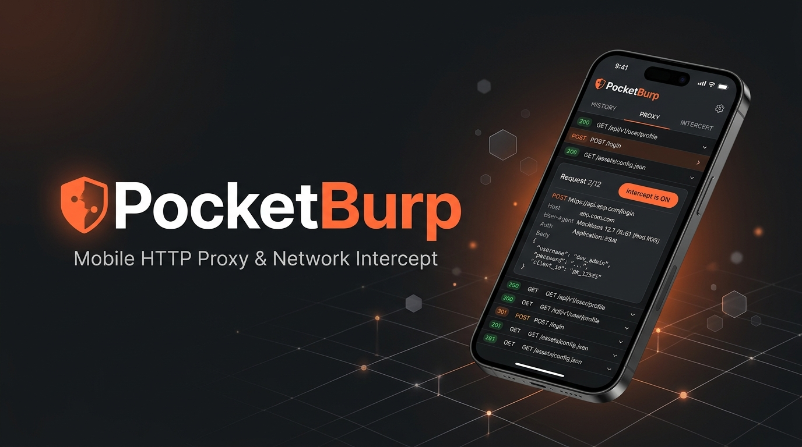
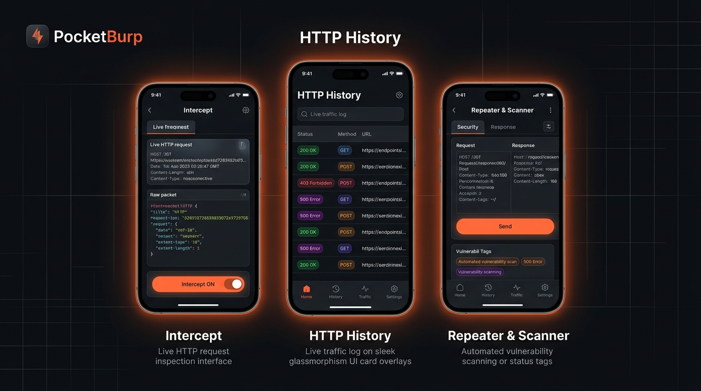
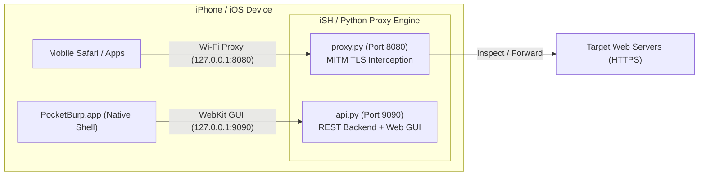

<p align="center">
  
</p>

<h1 align="center">PocketBurp</h1>

<p align="center">
  <b>A mobile, GUI-first intercepting HTTP/HTTPS proxy for iPhone</b><br>
  <i>A pixel-faithful replica of the Burp Suite Community Edition workflow running on iOS.</i>
</p>

<p align="center">
  <a href="https://github.com/Shashi552/pocketburp/watchers"></a>
  <a href="https://github.com/Shashi552/pocketburp/stargazers"></a>
  <a href="https://github.com/Shashi552/pocketburp/network/members"></a>
  <a href="https://github.com/Shashi552/pocketburp"></a>
</p>

<p align="center">
  <a href="https://github.com/Shashi552/pocketburp/actions/workflows/build-ipa.yml"></a>
  
  
  
  
  
</p>

---

<p align="center">
  
</p>

---

## ⚡ Overview

PocketBurp brings the core desktop web application security testing toolkit onto your iPhone:
- **Intercept**: Real-time HTTP/HTTPS request holding, header tampering, and body editing.
- **HTTP History**: Full searchable exchange log with status color-coding, request/response syntax viewer, and timing.
- **Repeater**: Craft, tweak, and replay requests on the fly with sub-millisecond response inspection.
- **Vulnerability Scanner**: Active fuzzing for Path Traversal / LFI, SQLi probes, Reflected XSS, and Open Redirects.
- **Root CA Installer**: One-tap Apple Configuration Profile (`.mobileconfig`) generation for native iOS TLS trust.

<p align="center">
  
</p>

---

## 🏗 Architecture



```
 Python backend (iSH Shell / Alpine)          Safari frontend
 ┌──────────────────────────────┐            ┌──────────────────────┐
 │ proxy.py  MITM engine :8080  │◄─── REST ─►│ http://127.0.0.1:9090│
 │ api.py    GUI + API   :9090  │            │  static/index.html   │
 └──────────────┬───────────────┘            └──────────────────────┘
                │ application-layer proxy (no root, no pcap)
                ▼
        target server / vulnerable app
```

Zero third-party Python packages, zero CDN links, zero internet needed.
Only `python3` + `openssl` from Alpine — ideal for iSH's ARM emulation.

---

## 1. Install (iSH Shell on iPhone)

```sh
apk update
apk add python3 openssl          # py3-pip not even required
```

Copy the `pocketburp/` folder into iSH (`~/pocketburp`), then:

```sh
cd ~/pocketburp
sh run.sh
```

You should see:

```
 PocketBurp 1.0   |   intercept. edit. replay. fuzz.

  proxy      : 0.0.0.0:8080  (listening on 0.0.0.0:8080)
  GUI        : http://127.0.0.1:9090
  CA cert    : ready (EE:0D:21:56:5A:79:EF:00)
  intercept  : OFF
```

Open **Safari → `http://127.0.0.1:9090`**. That is the whole GUI.
Keep iSH in the background; the proxy keeps running (enable iSH's background
audio/“run in background” so iOS does not suspend it).

`run.sh` options (passed straight through):

| Command | Effect |
|---|---|
| `sh run.sh` | proxy :8080 + GUI :9090 |
| `sh run.sh --demo` | same, plus sample traffic so you can explore the UI first |
| `sh run.sh --proxy-port 8888` | different proxy port |
| `sh run.sh --no-proxy` | GUI only (proxy stays stopped) |
| `sh run.sh --reset` | wipe history on start |

Environment overrides: `POCKETBURP_GUI_PORT`, `POCKETBURP_PROXY_PORT`.

---

## 2. Install it as an app (Home Screen icon, fullscreen, no Safari chrome)

PocketBurp ships a web-app manifest, a service worker and a full icon set, so it
behaves like a native app — and you can also build a real `.ipa` for LiveContainer
from the included Xcode project.

### A. Home Screen web app — works today, 20 seconds

1. iSH: `cd ~/pocketburp && sh run.sh`
2. Safari: open `http://127.0.0.1:9090`
3. Tap **Share → Add to Home Screen → Add**

You get the orange shield icon on the Home Screen. Launching it opens the
dashboard **fullscreen** (no URL bar), keeps your session, and the app still
auto-refreshes every 2 s. Long-pressing the icon shows shortcuts straight to
*Intercept*, *History*, *Repeater* and *Scanner* (`/?tab=…` deep links).

The first time you open it in iOS Safari *before* installing, a one-line banner
at the top says **Share → Add to Home Screen**. It appears only on iOS Safari,
never inside the installed app, never on desktop, and stays dismissed once you
tap ✕.

> iOS free-sideloading reality check: an "App"-mode web app still needs the iSH
> process alive, because a web app cannot listen on a TCP port. If iOS suspends
> iSH you'll see the "engine offline" state — reopen iSH and tap Retry.

### B. A real `.ipa` for LiveContainer (needs one cloud build)

`ipa/` contains a complete Xcode project (Swift + WKWebView shell, bundle id
`com.shashank.pocketburp`, team `MPZ586FDM5`, AppIcon asset catalog). I can't
compile a Mach-O binary in this sandbox — that needs macOS/Xcode — so the
project ships as source plus two paths that finish the job for you.

**On your Mac — one command:**

```bash
cd ipa && ./build-on-mac.sh --team MPZ586FDM5
```

That stages the Python engine into the app bundle, archives Release/arm64,
signs it, zips `Payload/` into `ipa/build/PocketBurp.ipa`, and prints the
architecture, minimum iOS, bundle id, engine file count and signature. Add
`--install` to push straight to a connected iPhone, `--doctor` to check your
toolchain without building, `--clean` to start over.

If it fails, do **not** paste raw Xcode output — generate the report instead:

```bash
cd ipa && ./verify-build.sh > ~/Desktop/pocketburp-report.txt 2>&1
```

and paste `pocketburp-report.txt`. It contains your Xcode version, the project
check, the staged engine listing, the IPA contents, the Info.plist keys, `lipo`
and `codesign` output and the last lines of the build log — and no Apple ID,
no provisioning-profile contents, no device tokens.

Full walkthrough — one-time setup, the four install routes, first-launch
behaviour and a troubleshooting table: **[`ipa/SIGNING-AND-INSTALL.md`](ipa/SIGNING-AND-INSTALL.md)**.

**No Mac at all:** push this folder to a GitHub repo → **Actions → “Build
PocketBurp.ipa” → Run workflow** → download the `PocketBurp-ipa` artifact
(unsigned; sign it with Sideloadly or LiveContainer).

Then in LiveContainer: **+ → import `.ipa` → launch**. The shell shows a native
splash, boots the WebView at `127.0.0.1:9090`, and if the engine isn't running it
shows a recovery card with **Retry** and **Open iSH Shell** instead of a blank page.

Why the shell needs an engine: only a real process can `bind()` port 8080/9090.
The Swift side therefore owns the window and the WebView, and the proxy runs in
iSH (or in an embedded Alpine once you add the iSH xcframework —
`EngineBridge.launchPythonEngine()` is the single integration point, and
`EngineBridge.seedProjectIfNeeded()` already copies the Python project into the
app's Documents folder on first launch).

> **Important (Sandbox crossing)**: iOS isolates each app into its own sandbox; iSH
> cannot access PocketBurp's app bundle directly. To get the engine into iSH,
> transfer `pocketburp-engine-for-iSH.zip` via Files/AirDrop and mount it in iSH.
> See detailed instructions in **[`ipa/SIGNING-AND-INSTALL.md §2b`](ipa/SIGNING-AND-INSTALL.md#2b-moving-the-engine-into-ish-shell-sandbox-crossing)**.


## 3. Point the iPhone at the proxy

**Settings → Wi-Fi → (your network) → Configure Proxy → Manual**

* Server: `127.0.0.1`
* Port: `8080`
* Authentication: off

> **Important:** add `127.0.0.1` to *Bypass for these Hosts* (or simply keep a
> second Safari tab open) so the GUI page itself is not sent through the proxy.
> If a request to `127.0.0.1:9090` ever gets proxied, PocketBurp answers with a
> clear “proxy loop detected” page.

Wi-Fi proxy settings apply to **apps that use NSURLSession/CFNetwork** (Safari,
most App Store apps). Apps that use their own proxy-disabled stack, or VPN-based
networking inside UTM-SE, can instead use PocketBurp's **SOCKS5** listener on the
same port (`127.0.0.1:8080`) — it accepts SOCKS5 CONNECT, MITMs TLS the same way,
and tunnels non-HTTP traffic raw.

---

## 4. Trust the CA (required for HTTPS)

1. Safari → `http://127.0.0.1:9090` → **CA Certificate** tab → **Download CA Certificate**.
   iOS asks *“This website is trying to download a configuration profile”* → **Allow**.
2. **Settings → General → VPN & Device Management → PocketBurp Root CA → Install**
   (passcode twice).
3. **Settings → General → About → Certificate Trust Settings** → toggle
   **PocketBurp Root CA** to ON.
4. Reload any HTTPS site. Requests now appear decrypted in **HTTP History**.

The CA is generated on first run:

```
certs/pocketburp-ca.key   2048-bit RSA, 10 years, mode 0600
certs/pocketburp-ca.crt   root certificate you install on the device
certs/hosts/<host>.crt    per-host leaf, 397 days (Apple's max), regenerated
certs/hosts/<host>.key    automatically on expiry
```

Apps using **certificate pinning** (banking, WhatsApp, Google apps) will reject
the forged certificate — expected, and identical to Burp on a laptop. Remove the
profile and reset the Wi-Fi proxy when you finish testing.

---

## 5. The GUI

| Tab | What it does |
|---|---|
| **Dashboard** | proxy RUNNING/STOPPED, port, intercepted / forwarded / dropped counters, huge **Intercept ON/OFF** toggle, Start/Stop proxy, live log of the last 5 requests, quick-setup checklist |
| **Intercept** | held requests as numbered chips (`#1`, `#2`, …), editable raw request editor, **Forward / Drop / Forward & Log**, Forward-all / Drop-all, “static: skip” toggles auto-forwarding of `.css/.js/.png/...` so Safari never hangs |
| **HTTP History** | sortable table (#, Method, Host/URL, Status, Length, Time), keyword / method / status filters, tap a row for the split request/response viewer with JSON/HTML syntax highlighting, `R`/`S` quick buttons on every row |
| **Repeater** | editable request on top, full raw response (status line + headers + body) below, Send / Clear, response time, session history of every send (tap to reload it) |
| **Scanner** | pick any history request, choose Path Traversal / XSS / SQLi / custom wordlist, choose injection points (query, body, JSON fields, path segment), live progress + results table with status, length and colour-coded flags (`5xx`, `length`, `reflected`, `time`) |
| **Scope** | one domain / wildcard / IP / CIDR per line, “only intercept in-scope” switch — out-of-scope traffic is forwarded untouched **and unlogged** |
| **CA Certificate** | subject, issuer, expiry, SHA-256 fingerprint, serial, one-tap download, iOS install/trust walkthrough |

Everything auto-refreshes every 2 s by polling the REST API; no page reloads, no
external assets, works with the phone in airplane-mode apart from the target.

Keyboard notes for iSH/Safari: the request editors are plain `<textarea>`s, so
long-press → Paste works normally with iSH's clipboard.

---

## 6. REST API

All JSON over HTTP on `:9090`.

```
GET  /api/status                     proxy + intercept + scope snapshot
POST /api/intercept/toggle           {"enabled": true|false}
POST /api/intercept/autoskip         {"enabled": true|false}
GET  /api/queue                      held requests (with raw text)
POST /api/queue/{id}/forward
POST /api/queue/{id}/drop
POST /api/queue/{id}/edit            {"raw": "<full raw request>"}
POST /api/queue/forward_all | /drop_all
POST /api/proxy/start  {"port": 8080}
POST /api/proxy/stop
GET  /api/history?q=&method=&status=&limit=&before_id=
GET  /api/history/{id}               raw request/response text
POST /api/history/clear
POST /api/repeater/send              {"raw": "...", "host","port","scheme"}
GET  /api/repeater/history | /api/repeater/entry/{id}
POST /api/scanner/run                {"request_id"|"raw", "attack", "wordlist", "points":[]}
GET  /api/scanner/results?scan_id=
GET  /api/scope   POST /api/scope    {"raw": "...", "enforced": bool}
GET  /api/ca/info | /api/ca/pem | /api/ca/download
```

---

## 7. Module map

| File | Responsibility | Talks to |
|---|---|---|
| `run.sh` | dependency check + single launcher | `pocketburp.py` |
| `pocketburp.py` | entry point: starts proxy thread + GUI server, signals, `--demo`/`--reset` | all |
| `proxy.py` | MITM engine: parses requests, handles `CONNECT`, TLS termination, SOCKS5, WebSocket upgrade, keep-alive, chunked/gzip framing, `send_raw_request()` shared by Repeater/Scanner | `ca`, `intercept`, `history`, `scope` |
| `ca.py` | root CA + per-host leaf certificates via the `openssl` CLI, `SSLContext` cache | `proxy` |
| `intercept.py` | held-request queue with blocking `wait()`, forward/drop/edit, static-asset auto-skip | `proxy`, `api` |
| `history.py` | SQLite storage (WAL, 1 MB body cap), filtered queries, raw-text reconstruction, gzip-aware display decoding | `proxy`, `scanner`, `api` |
| `scope.py` | scope file + wildcard/CIDR matching + “enforce” flag (`scope.txt`, `config.json`) | `proxy`, `api` |
| `repeater.py` | sends one edited request, keeps a 40-entry session history | `proxy`, `api` |
| `scanner.py` | payload families (traversal 17, XSS 13, SQLi 15), parameter injection for query/form/JSON/path, baseline diffing, reflection & anomaly detection, background thread | `proxy`, `history`, `api` |
| `api.py` | zero-dependency `http.server` REST API + static file server | everything |
| `static/index.html` | entire GUI: inline CSS + vanilla JS, Burp dark theme, 2 s polling | `api.py` |
| `static/manifest.webmanifest` | PWA manifest — name, icons, standalone display, shortcuts | iOS/Android |
| `static/sw.js` | service worker: caches the shell, never the API | `api.py` |
| `static/icons/*.png` | Home Screen / PWA icon set (generated) | `tools/make_icons.py` |
| `tools/make_icons.py` | renders every icon size with Pillow | — |
| `ipa/PocketBurp.xcodeproj` | Xcode project: Swift + WKWebView shell, the Python engine wired in as a folder reference, shared scheme | `build-on-mac.sh` |
| `ipa/build-on-mac.sh` | one-command Mac build: stage engine → archive → sign → `build/PocketBurp.ipa` (`--install`/`--doctor`/`--clean`) | Xcode, `codesign` |
| `ipa/verify-build.sh` | produces the paste-back diagnostic report when a build fails | Xcode, `plutil` |
| `ipa/SIGNING-AND-INSTALL.md` | Mac setup, signing, the four install routes, troubleshooting | — |
| `ipa/tools/check_pbxproj.py` | dependency-free project validator (brace balance, dangling UUIDs, missing files); runs anywhere, including here | `project.pbxproj` |
| `ipa/build-ipa.sh` | older CI-style packager, still used by the GitHub Actions workflow | Xcode |
| `.github/workflows/build-ipa.yml` | unsigned `.ipa` build on `macos-15` for people with no Mac | `build-ipa.sh` |
| `db/history.db` | SQLite database (created automatically) | `history.py` |
| `certs/` | CA + per-host certificates | `ca.py` |

### Request lifecycle

```
iPhone app ──► :8080 handler ──► scope check ──► intercept queue (if ON and not a static asset)
                                                        │  GUI Forward / Edit / Drop
                                                        ▼
                                        send_raw_request() ──► target (TLS if https)
                                                        │
                                        history.log() ◄─┘  response re-framed (Content-Length
                                                            recomputed) ──► back to the app
```

---

## 8. Notes for your CVE work

* **Path Traversal (`. ./.` in Node file servers)** — Scanner → *Path Traversal / LFI*,
  tick *Query string* and *Path segment*; the traversal family includes plain,
  `%2f`, `%2F`, double-encoded `%252f`, `....//`, backslash, overlong-UTF-8 and
  `package.json` payloads. Rows whose length jumps from the baseline are flagged.
* **WordPress plugin XSS / object injection** — History → tap the
  `admin-ajax.php` POST → edit the body in place → **Replay edited**, or
  `S` → *Reflected XSS* to sweep every parameter.
* **EDD payment bypass** — Intercept ON → trigger checkout → change
  `amount` / `status` / `payment_id` in the body → **Forward & Log**. Content-Length
  is recalculated for you, so shortened/lengthened bodies still parse server-side.
* **Trusted-cert pins** — you can always see the failure in History: the row is
  logged with the reason (“TLS handshake failed … Is the CA trusted?”).

---

## 9. Troubleshooting

| Symptom | Fix |
|---|---|
| Safari says “cannot connect to the server” for the GUI | iSH suspended; reopen iSH `sh run.sh`, keep the session alive |
| Every HTTPS site shows a certificate warning | CA installed but **not trusted** — Certificate Trust Settings |
| Safari hangs on a page while Intercept is ON | tap **Forward all**, or set `static: skip` |
| App traffic missing from History | that app ignores the Wi-Fi proxy — use its SOCKS/proxy setting with `127.0.0.1:8080`, or check Scope |
| `address already in use` | an old instance is running: `pkill -f pocketburp.py` then `sh run.sh` |
| History table grows huge | `--reset`, or History → **Clear history** |
| GUI reachable only from the phone | that's the default (`--host 127.0.0.1`). Use `--host 0.0.0.0` to expose it on the LAN, and remember the API has no auth |

---

## 10. Security notes

* The **GUI/API binds to `127.0.0.1`** by default and has no authentication. Only use
  `--host 0.0.0.0` on a trusted network, because anyone who can reach port 9090 can
  read your traffic history and replay requests.
* The **proxy binds to `0.0.0.0:8080`** so that apps inside LiveContainer / UTM-SE
  guests can reach it through the phone's LAN address. On an untrusted Wi-Fi network
  that is an open proxy — start it with `--proxy-host 127.0.0.1` when only Safari and
  on-device apps need it (`sh run.sh --proxy-host 127.0.0.1`).
* The CA private key lives at `certs/pocketburp-ca.key` (chmod 0600). Anyone with
  that file plus a device that trusts the CA can decrypt that device's TLS. Delete
  both the key and the installed profile when you are done.
* `--reset` and *Clear history* destroy captured traffic permanently; the DB is
  plain SQLite at `db/history.db`.

---

## 💡 The iSH Background Reality & Open for Suggestions

### The Mobile Background Challenge
iOS aggressively suspends or terminates background applications after 30–60 seconds to preserve battery life and system memory. Because iSH is an emulated x86 user-space environment running inside an iOS sandbox, keeping the proxy alive in the background presents a fundamental mobile OS challenge:
- **Location Keepalive (`/dev/location`)**: Reading `/dev/location` forces iOS CoreLocation to treat iSH as an active navigation/tracking app, preventing process suspension. While this allows standalone on-device usage without a PC, continuous location polling naturally increases battery usage over prolonged sessions.
- **The PC / Mac LAN Alternative**: Running `python3 pocketburp.py --host 0.0.0.0` on your computer on the same Wi-Fi network and pointing your iPhone's Wi-Fi proxy to it completely eliminates phone battery drain, avoids iOS background limits, and runs at native hardware speeds.

### 🤝 Open for Suggestions & Contributions!
PocketBurp is an evolving mobile security research experiment, and **we are completely open for suggestions, ideas, and community feedback!**

We would love your thoughts on:
1. **Background Keepalive Optimizations**: Lighter methods to keep the engine awake in iOS (e.g. low-frequency audio session vs. CoreLocation).
2. **Native Embedded Engine**: Integrating a lightweight native Swift / C proxy daemon directly into `PocketBurp.app` to eliminate the need for a separate iSH app.
3. **Network Extension / VPN Integration**: Exploring `NEPacketTunnelProvider` or WireGuard-style local TUN capture for transparent system-wide routing without manual Wi-Fi proxy configuration.
4. **UI & Feature Improvements**: New vulnerability scanner payloads, UI ergonomics, or packet filtering rules.

If you have ideas, feedback, or want to contribute:
- 👀 [**View Project Watchers**](https://github.com/Shashi552/pocketburp/watchers) or watch the repository to track developments
- 💡 [**Open a GitHub Discussion**](https://github.com/Shashi552/pocketburp/discussions)
- 🐛 [**Submit an Issue or Suggestion**](https://github.com/Shashi552/pocketburp/issues)
- 🚀 [**Submit a Pull Request**](https://github.com/Shashi552/pocketburp/pulls)

---

## 11. Legal

PocketBurp is for **authorized** security testing only — systems you own or have
written permission to assess. Intercepting traffic you are not entitled to test
is illegal in most jurisdictions. The default bind address (`127.0.0.1` for the
GUI) keeps the dashboard on-device.
